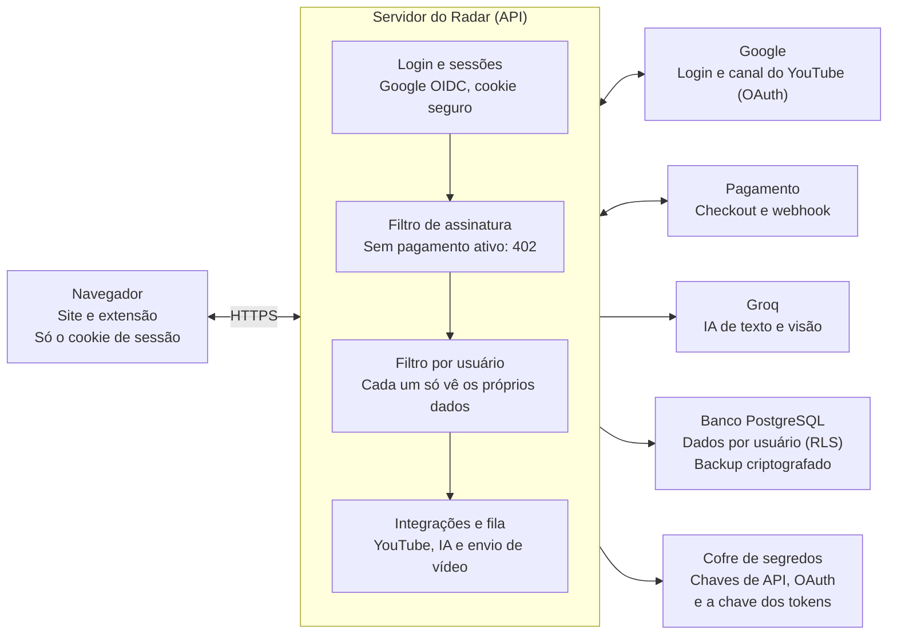

# Radar de Canais — Plano de Segurança, Pagamento e LGPD

Atualizado em 25/10/2026 · Documento único de referência para a versão vendida do Radar.
Versão online (com diagrama editável e comentários): https://claude.ai/artifact/VN3ztEavbTG1YjzswgSCzS

Tudo que for decidido ou mudado sobre login, pagamento, YouTube, dados e LGPD entra **neste arquivo**. No fim de cada fase, atualize a [Matriz de alinhamento final](#matriz-de-alinhamento-final) e o [Registro de decisões](#registro-de-decisões).

## Sumário

1. [Objetivo e princípios](#objetivo-e-princípios)
2. [Como está hoje](#como-está-hoje)
3. [Configuração local atual (.env)](#configuração-local-atual-env)
4. [Arquitetura alvo](#arquitetura-alvo)
5. [Fase 1 — Login com Google](#fase-1--login-com-google)
6. [Fase 2 — Pagamento e liberação de acesso](#fase-2--pagamento-e-liberação-de-acesso)
7. [Fase 3 — Conexão do canal do YouTube com consentimento](#fase-3--conexão-do-canal-do-youtube-com-consentimento)
8. [Fase 4 — Isolamento de dados por usuário](#fase-4--isolamento-de-dados-por-usuário)
9. [Fase 5 — LGPD e dados fora do frontend](#fase-5--lgpd-e-dados-fora-do-frontend)
10. [Fase 6 — Experiência do usuário](#fase-6--experiência-do-usuário)
11. [Ordem de execução e checklist antes de vender](#ordem-de-execução-e-checklist-antes-de-vender)
12. [Decisões em aberto e riscos](#decisões-em-aberto-e-riscos)
13. [Matriz de alinhamento final](#matriz-de-alinhamento-final)
14. [Registro de decisões](#registro-de-decisões)

---

## Objetivo e princípios

O Radar vai deixar de ser um programa que roda no PC da administração e virar um serviço vendido para várias pessoas. Cada uma entra só com a conta Google, paga, conecta o próprio canal e vê apenas os próprios dados.

Quatro regras valem para toda decisão deste plano:

1. **Sem pagamento, sem uso.** Quem não pagou vê só a tela de planos. O bloqueio é feito no servidor, em cada pedido, e não por botões escondidos na tela.
2. **Login só com Google, e o YouTube só com aprovação.** O usuário entra com a conta Google. A ligação com o canal do YouTube é um segundo passo, com uma tela de permissão do próprio Google que ele aprova e pode revogar.
3. **Nenhum dado sensível no navegador.** Tokens, chaves de API, e-mail de outros usuários e dados de pagamento ficam só no servidor. O navegador e a extensão recebem apenas um cookie de sessão e o que a tela precisa mostrar naquele momento.
4. **Configurar é um caminho guiado, não uma página de chaves.** O usuário nunca vê nem cola uma chave de API. Ele clica em "Conectar canal", aprova no Google e começa a usar.

O que fica de fora deste plano: mudanças no garimpo, nas métricas e na fábrica de vídeos, exceto onde elas tocam dados de usuário.

## Como está hoje

A pasta não é só um frontend: ela tem o servidor (FastAPI, `radar/servidor.py`, cerca de 190 rotas), o banco (SQLite em `dados/radar.db`), a tela (`radar/web`) e a extensão do Chrome (`extensao/`). Ela foi feita para um dono só, rodando no próprio PC, e o que ela tem hoje não serve para vender.

| Ponto | Como funciona hoje | Problema para vender | Onde está |
| --- | --- | --- | --- |
| Acesso | `RADAR_ABERTO=1` por padrão: quem acessa pelo próprio PC entra sem login, como administração | Num servidor na internet esse atalho tem que deixar de existir | `servidor.py` — `aberto()`, `_usuario_livre()` |
| Login | E-mail e senha (PBKDF2, 200 mil rodadas) e conta nova só com convite | Não há login com Google; senha própria é mais um dado para proteger | `servidor.py` (cadastro e entrada), `banco.py` — `hash_senha` |
| Sessão | Cookie `radar_sessao` httpOnly, SameSite=Lax, válido por 60 dias; o `secure` só liga com https | Sessão sem expiração no banco, sem lista de aparelhos e sem sair de todos | `servidor.py` — `_com_cookie`, tabela `sessoes` |
| Pagamento | Campos `plano` e `vence` no usuário, mudados à mão pela administração | Nada liga um pagamento real à liberação | `config.py` — `PLANOS`; `servidor.py` — `_plano`, `exigir` |
| Chaves de API | YouTube e Groq no `.env`, as mesmas para todos | Um usuário pode gastar a cota e o dinheiro de todos | `config.py`, `integracoes.py` |
| Canal do YouTube | OAuth do Google com escopos só de leitura e análise; `refresh_token` gravado em texto puro | Quem copiar o arquivo do banco tem acesso aos canais de todos | `studio.py`, tabela `studio` |
| Publicar vídeo | A extensão só mostra um painel no YouTube Studio; a pessoa copia e cola | Ainda não existe envio de vídeo pelo site | `publicar.py`, `extensao/publicar.js` |
| Dados por usuário | Tabelas pessoais já têm `usuario_id` (salvos, achados, alvos, studio, treinamentos...) | Bom ponto de partida, mas nada impede uma rota de esquecer o filtro | `banco.py` |
| Extensão | Guarda um token próprio em `chrome.storage.local`; pede acesso a `https://*/*` como opcional | O token vive no navegador; a permissão ampla assusta e é barrada na loja | `extensao/background.js`, `manifest.json` |

Pontos que já estão certos e devem ser mantidos: senha com sal e hash lento, token de sessão guardado só como hash, cookie httpOnly, `state` aleatório no OAuth e bloqueio depois de muitas senhas erradas.

## Configuração local atual (.env)

Isto vale para rodar e testar no PC hoje. Na versão vendida, o `.env` fica só para desenvolvimento e as chaves de produção vão para o cofre de segredos (ver [Arquitetura alvo](#arquitetura-alvo)).

- O `.env` fica na raiz do projeto e está no `.gitignore` (nunca sobe para o GitHub).
- O Radar lê o `.env` dele e, quando roda dentro da pasta da fábrica, completa com o `.env` da fábrica (`radar/config.py` — `_ambiente()`).
- **Obrigatórias:** `YOUTUBE_API_KEY` (aceita várias: `YOUTUBE_API_KEY1`, `YOUTUBE_API_KEY2`... ou separadas por vírgula; cada chave dá 10.000 unidades de cota por dia) e `GROQ_API_KEY`.
- **Opcionais:** `RADAR_COTA_POR_CHAVE`, `RADAR_COTA_GARIMPO`, `RADAR_MODELO_TEXTO`, `RADAR_MODELO_VISAO`, `RADAR_GOOGLE_CLIENT_ID`, `RADAR_GOOGLE_CLIENT_SECRET`, `RADAR_GOOGLE_REDIRECT` (padrão `http://localhost:8400/api/youtube/retorno`), `RADAR_FABRICA`, `FABRICA_URL`, `FABRICA_TOKEN`.
- **Atenção:** `RADAR_ABERTO`, `RADAR_PORTA`, `RADAR_GARIMPO_AUTOMATICO`, `RADAR_HTTPS` e `RADAR_ACORDADO` **não funcionam no `.env`**. O código lê essas variáveis só do ambiente do sistema (`os.environ`). Padrões: sem login, porta 8400, garimpo automático ligado.
- O garimpo automático roda cerca de 30 segundos depois de ligar o Radar e gasta cota da API do YouTube. Para testar sem gastar cota:

```powershell
$env:RADAR_GARIMPO_AUTOMATICO="0"; uv run python -m radar servidor
```

- **Antes do lançamento:** trocar todas as chaves que já estiveram em `.env` de qualquer PC (inclusive as de teste usadas agora).

## Arquitetura alvo

O Radar sai do PC e vai para um servidor na nuvem, com domínio próprio e HTTPS. Tudo que é dado ou segredo fica atrás do servidor; o navegador só conversa com a API do Radar.



Todo pedido passa pelos três filtros em ordem (sessão, assinatura, dono do dado) antes de tocar o banco ou um serviço de fora.

- **Dois ambientes:** testes e produção, cada um com banco, chaves e cliente OAuth próprios.
- **Cofre de segredos:** as variáveis do `.env` passam para o cofre da hospedagem. O `.env` fica só para desenvolvimento local, com chaves de teste.
- **Sem túnel para o PC:** o acesso pela Cloudflare ao PC da administração deixa de ser o caminho dos clientes.

## Fase 1 — Login com Google

O usuário entra com "Entrar com Google" e o servidor cria a sessão; a senha própria do Radar deixa de existir. O login pede só `openid email profile`, sem nenhuma permissão do YouTube.

1. **Criar o cliente OAuth no Google Cloud** num projeto só do Radar, separado do da fábrica.
    - Tipo "Aplicativo da Web", com o endereço de volta `https://<dominio>/auth/google/retorno`.
    - Preencher a tela de consentimento: nome, logo, e-mail de suporte, links da Política de Privacidade e dos Termos de Uso.
    - O segredo do cliente vai só para o cofre de segredos do servidor, nunca para o repositório nem para a tela.
2. **Fluxo de entrada no servidor** (Authorization Code com PKCE e `state`).
    - `GET /auth/google` gera `state` e `code_verifier`, guarda os dois no banco por 10 minutos e redireciona ao Google.
    - `GET /auth/google/retorno` confere o `state`, troca o código, valida o `id_token` (assinatura, `aud`, `iss`, `exp`) e exige `email_verified=true`.
    - O usuário é identificado pelo `sub` do Google, não pelo e-mail, porque o e-mail pode mudar.
3. **Mudar a tabela de usuários.**
    - Adicionar `google_sub` (único), `foto`, `ultimo_acesso` e `status` (`pendente`, `ativo`, `suspenso`, `excluido`).
    - Contas antigas: no primeiro login com Google, ligar pelo e-mail verificado e depois apagar o `senha_hash`.
4. **Sessão segura.**
    - Cookie `__Host-radar_sessao` com `Secure`, `HttpOnly`, `SameSite=Lax` e `Path=/`.
    - Validade de 30 dias, renovada com o uso; gravar `expira`, `ip` e `aparelho` na tabela `sessoes`.
    - Tela "Seus aparelhos" com "Sair de todos". Ao suspender ou excluir uma conta, apagar todas as sessões dela.
    - Toda rota que muda algo (POST, PUT, DELETE) confere a origem do pedido ou um token anti-CSRF.
5. **Desligar o acesso livre.** Remover `aberto()` e `_usuario_livre()` da versão vendida. O modo local fica só num perfil de desenvolvimento que não sobe para produção.
6. **Extensão do Chrome.** Ela entra pelo site: o usuário já logado clica em "Ligar extensão" e o servidor entrega um token curto (1 hora) que se renova. Assim nenhuma senha passa pela extensão e o token pode ser cortado pelo servidor.

**Pronto quando:** não existe nenhuma rota que responda dados sem sessão válida, e um teste automatizado percorre todas as rotas sem cookie e recebe 401.

## Fase 2 — Pagamento e liberação de acesso

O acesso é liberado pelo aviso (webhook) que a empresa de pagamento manda ao servidor, nunca pela tela que diz "pagamento aprovado". O Radar não recebe nem guarda número de cartão: o checkout é a página da própria empresa de pagamento.

1. **Escolher a empresa de pagamento** com assinatura recorrente, Pix, cartão e webhook assinado. Candidatas: Stripe, Mercado Pago, Asaas, Hotmart ou Kiwify (ver [Decisões em aberto](#decisões-em-aberto-e-riscos)).
2. **Criar as tabelas de cobrança.**
    - `assinaturas`: `usuario_id`, `plano`, `status` (`ativa`, `atrasada`, `cancelada`, `expirada`), `inicio`, `vence`, `id_externo`.
    - `eventos_pagamento`: o id de cada aviso recebido, para nunca processar o mesmo aviso duas vezes.
    - Os campos `plano` e `vence` da tabela `usuarios` passam a ser lidos só de `assinaturas`.
3. **Fluxo de compra.**
    - Usuário logado e sem assinatura cai na tela de planos. Ao escolher, o servidor cria a sessão de checkout com o `usuario_id` nos metadados e redireciona.
    - A rota `POST /webhooks/pagamento` confere a assinatura do aviso com o segredo do webhook, grava o evento e atualiza a assinatura.
    - A volta do checkout mostra "Confirmando pagamento" e consulta o servidor até o status virar `ativa`.
4. **Bloqueio no servidor.** Uma única dependência (`assinante`) entra em todas as rotas do produto. Sem assinatura ativa a resposta é 402 e a tela leva aos planos. Hoje cada rota usa `exigir(recurso)`; o novo filtro fica por cima dele.
5. **Atraso, cancelamento e reembolso.**
    - Pagamento atrasado: 3 dias de carência com aviso na tela, depois só leitura.
    - Cancelado: o acesso vai até o fim do período pago.
    - Reembolso ou contestação: suspende na hora e apaga as sessões.
6. **Portal do assinante.** Botão "Gerenciar assinatura" que abre o portal da empresa de pagamento, onde o usuário troca cartão, plano ou cancela.
7. **Tirar o convite.** O convite de hoje vira só cupom de teste dado pela administração, com prazo e limite de uso.

**Pronto quando:** um teste no modo de testes da empresa de pagamento cobre compra, renovação, atraso, cancelamento e reembolso, e cada um muda o acesso como descrito acima.

## Fase 3 — Conexão do canal do YouTube com consentimento

O canal é ligado num passo separado do login, pela tela de permissão do Google, e cada permissão é pedida só quando o usuário usa a função que precisa dela. Os tokens ficam criptografados no servidor e o usuário pode desligar o canal a qualquer momento.

1. **Permissões em degraus** (autorização incremental, `include_granted_scopes=true`):

    | Quando pedir | Escopo | Para quê |
    | --- | --- | --- |
    | Ao clicar em "Conectar canal" | `youtube.readonly` | Ler o canal, os vídeos e as playlists |
    | Ao abrir as métricas do Studio | `yt-analytics.readonly` | Views, retenção e público |
    | Ao abrir a receita (canal monetizado) | `yt-analytics-monetary.readonly` | Receita estimada |
    | Ao clicar pela primeira vez em "Publicar no canal" | `youtube.upload` | Enviar vídeo, título, descrição, tags e miniatura |

    Hoje `studio.py` pede os três escopos de leitura de uma vez; isso muda para os degraus acima.

2. **Verificação do app no Google.** `youtube.upload` e os de leitura são escopos sensíveis. Antes de vender é preciso:
    - Domínio próprio verificado no Google Search Console.
    - Política de Privacidade pública explicando o uso de cada escopo.
    - Vídeo de demonstração do fluxo de consentimento e pedido de verificação do app.
    - Sem verificação, o Google mostra "app não verificado" e limita o app a 100 usuários.
    - Os vídeos enviados pela API por um projeto não auditado ficam privados. Pedir a auditoria dos Serviços de API do YouTube.
3. **Guardar os tokens com segurança.**
    - `refresh_token` e `access_token` criptografados (AES-GCM) com uma chave que fica no cofre de segredos, fora do banco.
    - O access token nunca sai do servidor; a tela pede "publicar" e o servidor fala com o YouTube.
    - Gravar quais escopos foram concedidos e quando, para mostrar ao usuário e para a LGPD.
4. **Conferir o dono do canal.** O canal só entra em "Meus canais" se vier do `channels?mine=true` daquele token. Um usuário não pode ligar o canal de outra pessoa digitando um id.
5. **Desconectar.** Botão "Desconectar canal" que chama o endpoint de revogação do Google, apaga os tokens e os dados do Studio daquele canal. Se o Google responder `invalid_grant` (o usuário revogou pelo Google), marcar o canal como desconectado e avisar na tela.
6. **Publicar vídeos pelo site.**
    - Envio retomável (resumable upload) direto do servidor, com fila e barra de progresso.
    - Antes de enviar, mostrar título, descrição, tags, visibilidade e "conteúdo para crianças" para o usuário confirmar. Nada é publicado sem um clique dele.
    - Cada envio gasta cota da API do projeto do Radar (cerca de 1.600 unidades de 10.000 por dia; conferir a tabela atual do Google). Limitar envios por usuário por dia e pedir aumento de cota ao Google.

**Pronto quando:** um usuário de teste conecta o canal, publica um vídeo privado, desconecta, e o token deixa de funcionar no Google.

## Fase 4 — Isolamento de dados por usuário

Cada pedido carrega o `usuario_id` da sessão, e o banco nunca devolve uma linha de outro usuário, mesmo que uma rota esqueça o filtro. A pesquisa pública de mercado (canais, vídeos, outliers) continua compartilhada, porque vem de dados públicos do YouTube.

1. **Separar o que é de todos do que é de cada um.**

    | Tipo | Tabelas | Regra |
    | --- | --- | --- |
    | Público, compartilhado | `canais`, `videos`, `leituras`, `outliers`, `historico`, `garimpos`, `buscas_feitas`, `termos_auto` | Leitura para todo assinante; só o servidor escreve |
    | Pessoal | `salvos`, `achados`, `alvos`, `ideias_salvas`, `modelar`, `treinamentos`, `treino`, `bloqueios`, `meus_canais`, `canais_config`, `canais_inscritos`, `thumb_projetos`, `radar_projetos`, `projetos_roteiro`, `resultado_*` | Só o dono lê e escreve |
    | Sensível | `studio` (tokens), `sessoes`, `assinaturas`, `usuarios` | Só o servidor; nunca vai inteiro para a tela |

2. **Trocar o SQLite por PostgreSQL** gerenciado, com backup diário criptografado. O SQLite em um arquivo no PC não aguenta vários usuários ao mesmo tempo nem separa permissões.
3. **Proteção em duas camadas.**
    - No código: uma função única de consulta (`banco.do_usuario(u, ...)`) que sempre acrescenta `usuario_id = ?`. Proibir SQL solto nas tabelas pessoais.
    - No banco: Row Level Security do PostgreSQL nas tabelas pessoais, com o `usuario_id` da sessão setado no início de cada pedido.
4. **Ids que não dão para adivinhar.** Projetos e itens pessoais passam a usar UUID nas URLs em vez de 1, 2, 3.
5. **Chaves de API e custo por usuário.**
    - As chaves do YouTube e do Groq continuam do Radar, no cofre de segredos. O usuário não cola chave nenhuma.
    - Cada uso grava `usuario_id` no gasto (as tabelas `cota` e `cota_motivo` ganham essa coluna).
    - Limite por plano: buscas, análises de IA e envios por dia. Ao bater o limite a tela avisa, sem quebrar.
    - A aba Integrações fica só para a administração.
6. **A fábrica.** Hoje produzir é só da administração (`dono_da_fabrica`). Se virar recurso vendido, cada pedido de produção leva o `usuario_id` e os arquivos vão para uma pasta ou bucket por usuário.

**Pronto quando:** um teste cria dois usuários, grava dados no primeiro e confirma que o segundo recebe 404 em todas as rotas pessoais, inclusive trocando ids na URL.

## Fase 5 — LGPD e dados fora do frontend

O Radar guarda só o mínimo para funcionar, diz ao usuário o que guarda e por quê, e entrega ou apaga tudo quando ele pede. Nenhum dado pessoal fica no navegador, na extensão, nos logs ou na URL.

1. **Mapa de dados** (registro das operações, pedido pela LGPD):

    | Dado | Para quê | Base legal | Quanto tempo |
    | --- | --- | --- | --- |
    | Nome, e-mail, foto e `sub` do Google | Conta e login | Execução de contrato | Enquanto a conta existir |
    | Tokens do YouTube | Ler métricas e publicar | Consentimento (tela do Google) | Até desconectar o canal |
    | Dados do Studio do canal | Mostrar métricas privadas | Consentimento | Até desconectar o canal |
    | Assinatura e histórico de pagamento | Cobrança e nota fiscal | Obrigação legal | O prazo fiscal (confirmar com o contador) |
    | IP e aparelho da sessão | Segurança | Legítimo interesse | 90 dias |
    | Projetos, salvos, roteiros | O próprio produto | Execução de contrato | Enquanto a conta existir |

2. **Documentos públicos** no site, antes do primeiro login: Política de Privacidade, Termos de Uso e o contato do encarregado de dados (DPO). Listar os operadores que recebem dados: Google, Groq, a empresa de pagamento e a hospedagem.
3. **Consentimento registrado.** No primeiro login, aceite dos Termos e da Política, gravado com versão, data e IP. Mudou a política, pedir de novo.
4. **Direitos do titular, dentro da conta.**
    - "Baixar meus dados": um arquivo JSON com tudo que é dele.
    - "Excluir minha conta": cancela a assinatura, revoga os tokens do Google e apaga os dados pessoais em até 15 dias. Guarda só o que a lei fiscal exige.
    - Corrigir nome e e-mail: vem do Google, atualizado a cada login.
5. **Regras para o frontend e a extensão.**
    - Nada de token, chave, e-mail de terceiros ou dado de pagamento no HTML, no JavaScript, no `localStorage` ou no `chrome.storage`.
    - A API devolve só os campos que a tela usa (listas de campos permitidos por rota), nunca a linha inteira do banco.
    - Nenhum dado pessoal em parâmetro de URL.
    - Cabeçalhos de segurança: Content-Security-Policy, HSTS, `X-Frame-Options: DENY`, `Referrer-Policy: same-origin`.
6. **Logs e auditoria.**
    - Logs sem e-mail, token nem corpo de pedido; usar o `usuario_id`.
    - Tabela `auditoria` para ações sensíveis: login, conectar ou desconectar canal, publicar, exportar, excluir, ações da administração.
    - A administração vê dados de um usuário só com motivo registrado.
7. **Plano de incidente.** Quem avisa, em quanto tempo, como trocar as chaves e como comunicar à ANPD e aos usuários atingidos. Testar uma vez antes de lançar.

**Pronto quando:** um advogado revisou Política e Termos, e o teste de exportar e excluir conta passa sem deixar dado pessoal no banco.

## Fase 6 — Experiência do usuário

Do primeiro clique ao primeiro vídeo publicado, o usuário passa por cinco telas e nunca digita uma chave, uma senha ou um id de canal. Cada passo mostra em uma frase o que vai acontecer e o que o Radar vai poder fazer.

1. **Entrar.** Um botão: "Entrar com Google". Abaixo, os links de Termos e Privacidade.
2. **Escolher o plano.** Os planos lado a lado, com o que cada um abre. O pagamento abre na página da empresa de pagamento e volta com "Pagamento confirmado".
3. **Conectar o canal.** "Conectar meu canal do YouTube", com a lista do que o Radar vai poder ver. Se a conta Google tiver vários canais, o usuário escolhe quais entram.
4. **Configurar a produção.** Voz, língua, duração, estilo de roteiro e de thumbnail, já sugeridos a partir do próprio canal. Tudo pode ser trocado depois.
5. **Primeiro vídeo.** Escolher uma ideia sugerida do nicho e mandar produzir. O painel abre na tela de Produção, com o vídeo na fila.

As telas 3, 4 e 5 formam o acesso guiado fixo descrito logo abaixo.

Depois do início:

- **Minha conta** em um lugar só: plano e vencimento, canais conectados (com o que cada um permite), aparelhos logados, baixar meus dados e excluir conta.
- **Publicar** pede a permissão de envio só na primeira vez e mostra uma prévia do vídeo no canal antes do clique final.
- **Mensagens de erro em português simples** e com o próximo passo. Exemplo: "O Google desconectou seu canal. Clique em Conectar para ligar de novo."
- **Aviso antes de travar:** vencimento em 3 dias, cota do dia em 80%, canal desconectado.
- **Extensão:** instalar pela loja do Chrome e ligar com um clique a partir do site já logado.

### Acesso guiado fixo: primeiro o canal, depois a produção

Quem acabou de pagar passa por um guia fixo de duas etapas, em ordem: **1. adicionar o canal** e **2. produzir o primeiro vídeo**. O guia fica por cima do painel e não fecha com o X, com o Esc nem clicando fora. O resto do produto só abre quando o primeiro vídeo entra na fila de produção.

**Como o guia sabe onde o usuário está**

- A tabela `usuarios` ganha a coluna `onboarding`, que só anda para a frente: `conectar_canal` → `configurar_producao` → `primeiro_video` → `concluido`.
- Quem decide é o servidor: a rota `/api/eu` devolve a etapa atual, e a tela só mostra o que o servidor mandou. Apagar o guia pelo navegador não libera nada. Enquanto a etapa não for `concluido`, as rotas do produto devolvem 409 com o nome da etapa; só as rotas do próprio guia respondem.
- Se o usuário fechar o navegador no meio, ao voltar o guia abre exatamente na etapa e no passo onde ele parou, com o que já tinha escolhido.
- Uma barra no topo do guia mostra as duas etapas: "1. Canal" e "2. Produção". A etapa atual fica destacada e a concluída ganha um sinal de feito.
- Se o canal for desconectado depois (pelo botão do Radar ou pelo Google, com `invalid_grant`), o guia volta só na Etapa 1, com o texto "Seu canal foi desconectado. Conecte de novo para continuar". A produção já configurada fica guardada.

**Etapa 1 de 2 — Adicionar o canal**

1. **Boas-vindas.** "Pagamento confirmado. Vamos começar pelo seu canal do YouTube."
2. **O que o Radar vai poder fazer.** Uma lista curta em português simples: ver o canal, os vídeos e as métricas. Uma linha dizendo o que ele **não** faz: não publica nada sem o seu clique e não vê sua senha. Link para a Política de Privacidade.
3. **Botão "Conectar meu canal do YouTube".** Abre a tela de permissão do Google (Fase 3, escopo `youtube.readonly`) na mesma aba e volta para o pop-up.
4. **Escolher os canais**, se a conta Google tiver mais de um canal. Cada canal aparece com foto, nome e inscritos, e o usuário marca quais entram. O primeiro marcado é o canal da produção na Etapa 2.
5. **Confirmação.** "Canal conectado", com foto e nome, e o botão "Ir para a produção". A etapa passa para `configurar_producao`.

Erros da Etapa 1:

| Situação | O que o guia mostra |
| --- | --- |
| O usuário clicou em "Cancelar" no Google | "Sem a permissão não dá para ver seu canal." e o botão "Tentar de novo" |
| A conta Google não tem canal no YouTube | "Essa conta não tem canal. Entre com a conta do canal ou crie um no YouTube.", com o link de criar canal e o botão "Usar outra conta Google" |
| O login no Google demorou mais de 15 minutos | "O tempo acabou. Clique em Conectar de novo." |
| O canal já está conectado por outra conta do Radar | "Esse canal já está ligado a outra conta. Fale com o suporte." O canal não é ligado a duas contas |
| Falha de rede ou do Google | "Não conseguimos falar com o Google agora. Tente de novo em instantes.", com o botão de tentar de novo |

**Etapa 2 de 2 — Produção**

A produção usa a configuração por canal que já existe hoje (`radar/producao.py`, rota `/api/producao/{canal_id}`): perfil e voz, estilo de roteiro, duração, língua, estilo de thumbnail e IA de imagem. O guia pede isso em telas curtas, com tudo já preenchido por sugestões tiradas do canal conectado.

1. **Língua e duração.** A língua vem do canal. A duração sugerida é a média dos vídeos do canal, ou 8 minutos se ele for novo.
2. **Voz.** Uma lista de vozes da língua escolhida, cada uma com um botão para ouvir uma amostra. O usuário escolhe uma.
3. **Estilo do roteiro e da thumbnail.** Modelos prontos com uma linha de explicação cada, e a IA de imagem (Gemini ou ChatGPT). O botão "Usar as sugestões" preenche tudo de uma vez. A etapa passa para `primeiro_video`.
4. **Primeiro vídeo.** Três ideias tiradas dos outliers do nicho do canal, cada uma com título e o motivo da sugestão, e um campo "Ou escreva seu tema". O usuário escolhe uma e vê o tempo estimado da fila (`/api/fila/estimativa`).
5. **Produzir.** O botão "Produzir meu primeiro vídeo" põe o vídeo na fila. A etapa passa para `concluido`, o guia some e o painel abre na tela de Produção, com o progresso do vídeo. Não é preciso esperar o vídeo ficar pronto para usar o resto do produto.

Erros da Etapa 2:

| Situação | O que o guia mostra |
| --- | --- |
| Nenhuma voz disponível na língua do canal | "Ainda não temos voz em <língua>." e a opção de escolher outra língua de narração |
| O plano não inclui produção ou o limite do mês acabou | "Seu plano não inclui mais vídeos este mês.", com o botão "Ver planos". A etapa vira `concluido` para não prender quem não pode produzir |
| A fábrica está fora do ar ou a fila está cheia | "A produção está ocupada agora. Seu vídeo entra na fila assim que der.", e o pedido fica guardado |
| A produção falhou depois de entrar na fila | Aviso na tela de Produção, não no guia: "Seu vídeo não foi produzido. Tentar de novo?" O guia não volta |

**Requisito para a Etapa 2 funcionar:** hoje produzir é só da administração (`dono_da_fabrica` em `servidor.py`) e a fábrica roda no PC. Para o guia, a produção precisa estar liberada para assinantes, com limite de vídeos por plano. Cada pedido também precisa levar o `usuario_id`, e a fábrica tem que rodar no servidor, com arquivos separados por usuário (Fase 4, item 6).

**O que fica liberado enquanto o guia está aberto**

- O menu da conta (sair, "Gerenciar assinatura", suporte e "Excluir minha conta"). O usuário que pagou nunca fica preso sem conseguir sair ou cancelar.
- A extensão do Chrome mostra só "Termine o início no site do Radar", com um link que abre o guia na etapa atual.

**Como construir**

- Um componente `AcessoGuiado` em `radar/web/app.js`, aberto antes de qualquer outra tela quando `onboarding !== "concluido"`, com uma tela por passo.
- Rotas do guia: `GET /api/guia` (etapa e respostas salvas), `POST /api/guia/producao` (salva a configuração) e `POST /api/guia/primeiro-video` (põe na fila). Todas conferem a etapa no servidor e recusam pular etapa.
- Acessibilidade: `role="dialog"`, `aria-modal="true"`, o foco fica dentro do guia, e tudo funciona pelo teclado e no celular.
- Gravar em `auditoria` os eventos `guia_inicio`, `canal_conectado`, `producao_configurada`, `primeiro_video_na_fila` e `guia_erro`, com o motivo, para saber onde as pessoas travam.
- Nenhum token ou id interno aparece na tela ou na URL. A volta do Google cai no servidor, que redireciona para `/#/bem-vindo` sem parâmetros.

**Pronto quando:** um usuário recém-pago não consegue usar nenhuma rota do produto antes de concluir o guia. Também não consegue pular da Etapa 1 para a 2 nem da 2 para o painel. O guia retoma do ponto certo depois de fechar o navegador, termina com um vídeo na fila, e cada linha das duas tabelas de erros foi testada.

**Pronto quando (Fase 6 inteira):** três pessoas de fora, sem ajuda, vão do login ao primeiro vídeo privado publicado em menos de 10 minutos.

## Ordem de execução e checklist antes de vender

A ordem segue as dependências: primeiro a base no servidor, depois quem é o usuário, depois o que é dele, e só então cobrar. Os pedidos de verificação ao Google saem logo no começo, porque dependem do Google e podem levar semanas.

1. **Base** (ver [Arquitetura alvo](#arquitetura-alvo)): domínio, HTTPS, servidor na nuvem, PostgreSQL, cofre de segredos e um ambiente de testes separado do de produção. No mesmo dia, publicar Política de Privacidade e Termos (rascunho) e verificar o domínio no Google.
2. **Fase 1 — Login com Google.** Junto, pedir a verificação do app OAuth.
3. **Fase 4 — Isolamento de dados.** Antes de entrar o segundo usuário de verdade.
4. **Fase 2 — Pagamento,** no modo de testes da empresa de pagamento.
5. **Fase 3 — Canal do YouTube,** primeiro só leitura, depois envio. Junto, pedir a auditoria da API do YouTube.
6. **Fase 5 — LGPD,** com o advogado revisando os textos.
7. **Fase 6 — Experiência,** testada com três pessoas de fora.
8. **Beta fechado** com 10 a 20 assinantes reais (o Google libera até 100 usuários sem verificação), depois o lançamento.

Checklist de segurança, a conferir antes do lançamento:

- [ ] Nenhum segredo no repositório (rodar um verificador como gitleaks em todo o histórico)
- [ ] Todas as chaves que já estiveram em `.env` de PCs foram trocadas
- [ ] Teste automático: todas as rotas sem sessão devolvem 401 e sem assinatura devolvem 402
- [ ] Teste automático: usuário B não enxerga nada do usuário A
- [ ] Tokens do YouTube criptografados no banco e chave fora do banco
- [ ] Webhook de pagamento confere a assinatura e ignora aviso repetido
- [ ] Cookies `Secure`, `HttpOnly`, `SameSite` e proteção contra CSRF
- [ ] Cabeçalhos CSP, HSTS e `X-Frame-Options` ativos
- [ ] Limite de pedidos por usuário e por IP no login, na IA e nos envios
- [ ] Dependências sem falhas conhecidas (`pip-audit`) e atualizadas
- [ ] Backup do banco testado com uma restauração de verdade
- [ ] Exportar e excluir conta funcionando de ponta a ponta
- [ ] Extensão sem `https://*/*` e sem token de longa duração
- [ ] Um teste de invasão (pentest) básico feito por alguém de fora

## Decisões em aberto e riscos

As quatro primeiras decisões precisam ser tomadas antes da Fase 2; as duas últimas podem esperar o beta.

- [ ] **Empresa de pagamento.** Stripe e Asaas dão mais controle pelo webhook. Hotmart e Kiwify já trazem afiliados e nota fiscal, mas o webhook é mais limitado.
- [ ] **Quem paga a cota e a IA.** O Radar paga tudo e limita por plano (recomendado, o usuário só faz login), ou o usuário avançado traz a própria chave como opção.
- [ ] **Onde hospedar.** Uma nuvem com PostgreSQL gerenciado e cofre de segredos (por exemplo Railway, Render, Fly.io, Google Cloud ou AWS). Se der, usar servidores no Brasil.
- [x] **A fábrica entra no plano?** Sim (decidido em 25/10/2026 com o acesso guiado). Ela precisa sair do PC e separar arquivos por usuário. Falta definir quantos vídeos por mês cada plano inclui.
- [ ] **Teste grátis:** dias de teste com cartão, plano grátis limitado, ou nenhum.
- [ ] **O plano Grátis de hoje (só extensão)** continua existindo, ou todo uso passa a exigir pagamento.

| Risco | O que acontece | Como evitar |
| --- | --- | --- |
| Google demora ou recusa a verificação | Lançamento travado em 100 usuários e vídeos só privados | Pedir no início; pedir só os escopos usados; vídeo de demonstração claro |
| Cota do YouTube acaba | Buscas e envios param para todos | Limite por usuário, cache das buscas, pedido de aumento de cota |
| Vazamento do banco | Tokens e dados de clientes expostos | Tokens criptografados, chave fora do banco, plano de incidente |
| Rota que esquece o filtro de usuário | Um cliente vê dados de outro | Função única de consulta, Row Level Security e teste com dois usuários |
| Acesso liberado sem pagamento | Perda de receita | Liberação só pelo webhook assinado |
| Custo de produção (voz e IA) maior que o preço do plano | Cada assinante dá prejuízo | Limite de vídeos por plano, custo por vídeo medido em `custos.py`, aviso ao chegar perto do limite |
| Chaves antigas em PCs de sócios | Uso indevido das contas do Radar | Trocar todas as chaves no lançamento |

## Matriz de alinhamento final

Cada pedido original liga às fases que o atendem e ao teste que prova que foi feito. No fim, todas as linhas precisam estar com o teste passando antes da venda.

| Pedido original | Onde é resolvido | Teste que comprova | Status |
| --- | --- | --- | --- |
| 1. Usar o sistema só depois do pagamento | Fase 2 (webhook, filtro `assinante`), Fase 1 (sem acesso livre) | Rotas sem assinatura devolvem 402; teste de compra, atraso, cancelamento e reembolso | Não iniciado |
| 2. Login Google e YouTube com aprovação do usuário | Fase 1 (OIDC, sessão), Fase 3 (escopos em degraus, revogação, verificação do app) | Rotas sem sessão devolvem 401; conectar, publicar privado, desconectar e token revogado | Não iniciado |
| 3. Dados e LGPD nunca no frontend | Arquitetura alvo, Fase 4 (isolamento, RLS), Fase 5 (mapa de dados, direitos, regras do frontend) | Usuário B recebe 404 nos dados de A; exportar e excluir conta; varredura sem segredo no HTML, JS e `chrome.storage` | Não iniciado |
| 4. Fácil configurar contas, criar e publicar vídeos | Fase 6 (5 telas e acesso guiado fixo: canal, depois produção), Fase 3 (publicar pelo site), Fase 4 item 6 (fábrica por usuário) | Usuário recém-pago só usa o produto depois de conectar o canal e pôr o primeiro vídeo na fila; 3 pessoas de fora vão do login ao primeiro vídeo privado em menos de 10 minutos | Não iniciado |
| Base: sair do PC para um servidor seguro | Arquitetura alvo, item 1 da ordem de execução | Produção com HTTPS, cofre de segredos, backup restaurado com sucesso | Não iniciado |

## Registro de decisões

Anote aqui cada decisão tomada, mais recente primeiro, para que a implementação siga o que foi combinado.

| Data | Decisão | Motivo | Quem decidiu |
| --- | --- | --- | --- |
| 25/10/2026 | O acesso guiado fixo ganha a Etapa 2: depois do canal, configurar a produção e pôr o primeiro vídeo na fila. Com isso a produção entra no plano vendido | O assinante sai do início já produzindo, sem tela solta para descobrir sozinho | Usuário |
| 25/10/2026 | Depois do pagamento, um pop-up fixo obriga a conectar o canal antes de usar o produto | Garantir que todo assinante comece pelo canal e tenha resultado logo no primeiro acesso | Usuário |
| 25/10/2026 | Plano criado; ordem de execução: Base → Fase 1 → Fase 4 → Fase 2 → Fase 3 → Fase 5 → Fase 6 → Beta | Seguir as dependências e começar cedo as verificações do Google | — |
